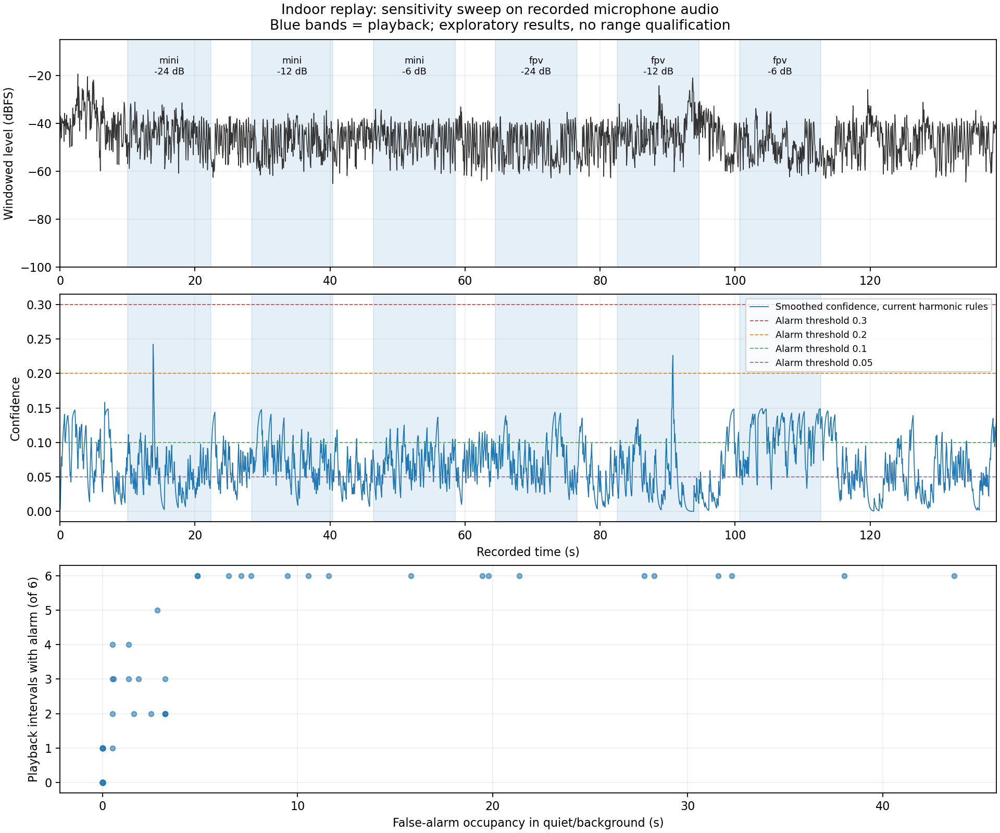

# Indoor Bluetooth replay, 2026-10-24

The XIAO ESP32-S3 / INMP441 Wi-Fi detector recorded **138.752 seconds** of a
short indoor playback experiment. Both drone source clips caused alarms when
fed directly into the default detector offline, but none of the six physical
speaker replays caused a live alarm. An offline threshold sweep could produce
alarms during all six replays, at the cost of alarms in quiet periods too.
These findings do not establish a useful detection threshold or detection range.

## Setup and provenance

- Physical speaker-to-microphone distance: **12 ft**, supplied by the operator.
  This is not an emulated drone distance.
- Seeed XIAO ESP32-S3 with external INMP441, left channel, D3/D4/D5 (GPIO4/5/6).
- Bluetooth speaker, fixed system volume during the run; direct Wi-Fi capture
  to a PC. No LoRa gateway or radio-range test.
- Indoors, no calibrated sound-pressure measurement. Microphone height,
  background-noise sources, speaker frequency response, and Bluetooth latency
  were not measured. The displayed dBA estimates are uncalibrated.
- Mini 4 Pro and 5-inch FPV clips linked from the
  [Saturday test page](https://paulrenzi.github.io/tripwire/weekend-test.html).
  Source MP3 hashes are in the submitted session metadata.
- Each clip played for approximately 12 seconds at relative digital gains
  −24, −12, and −6 dB, with 6-second quiet gaps; initial background 10 seconds,
  final background 20 seconds. The speaker's system volume was 50%.
- This is a short indoor adaptation, not the page's calibrated outdoor
  distance ladder with three repetitions per distance.

The live results were submitted as
[`xiao01-wifi-indoor/S20261024-142725-indoor`](https://tripwire-sessions.paulmichaelrenzi.workers.dev/sessions/xiao01-wifi-indoor/S20261024-142725-indoor)
and verified by reading the JSON back at submission time. That session contains
14 runs and 2,201 events. Offline simulated alarms were not submitted as live
alarms. The API is an external public test-data store, not a guaranteed archive.

The three recorded WAV segments (60 s, 60 s, 18.752 s) remain on the test PC.
They are deliberately excluded from Git: the microphone also captured the room,
and no raw room audio is distributed with this contribution. Consequently the
checked-in report can be inspected but this specific sweep cannot be reproduced
from the repository alone. The scripts can reproduce it with the original
capture folder or with a new recorded session.

## Capture quality and live result

| Measurement | Result |
|---|---:|
| Recorded audio | 138.752 s, PCM16 mono, 16 kHz |
| Recorded sample-offset gaps | 0 |
| I2S DMA overflows during recording | 0 |
| Clipped samples | 0 |
| Transport-drop counter increase during recording | 0 |
| Live alarm transitions during playback / background | 0 / 0 |

The cumulative transport-drop counter was 8,880 at both recording start and end;
that is not 8,880 drops inside this recording. Unconnected time also contributes
to the current firmware's cumulative counter.

## Offline sensitivity sweep

`tools/analyze_sensitivity.py` reconstructs the firmware's 1024-sample Hann-window
FFT, harmonic checks, confidence EMA, and alarm state machine. It explores 180
combinations of RMS gate, harmonic thresholds, spectral SNR threshold, and
confidence threshold; the two-frame alarm sustain remains unchanged.

The harmonic scan was checked against the actual compiled C implementation for
all 2,168 recorded frames, both with default thresholds and the relaxed profile.
There were zero harmonic boolean disagreements; the largest confidence absolute
error was below 0.000001. Reconstructed levels differed from the live level
telemetry by a median 0.013 dB and a maximum 0.095 dB. The baseline replay produced
zero alarms, agreeing with the live run. This is host-replay agreement, not
bit-identical ESP-DSP execution: the WAVs retain 16 bits of the original 24-bit
microphone data, and NumPy supplies the FFT.

The scoring omits 0.75 seconds at each phase edge because playback/receiver
clock alignment and Bluetooth latency are approximate. A play is counted below
when an alarm is active within its scored interior; starts are also retained in
the JSON to distinguish carryover alarms.

| Profile | Plays with an alarm | Quiet/background alarm starts | Quiet/background alarm occupancy |
|---|---:|---:|---:|
| Default: confidence on/off 0.30/0.18 | 0/6 | 0 | 0 s |
| Confidence on/off 0.20/0.12 | 1/6 | 0 | 0 s |
| Confidence on/off 0.10/0.06 | 1/6 | 0 | 0 s |
| Confidence on/off 0.02/0.012 | 2/6 | 1 | 0.512 s |
| Harmonic thresholds halved, confidence on/off 0.05/0.03 | 6/6 | 6 | 4.864 s |

For the last row, harmonic power-ratio thresholds H2/H3 are 0.035/0.0175,
compared with defaults 0.07/0.035. Spectral SNR minimum remains 4, RMS gate
remains 0.00003, and sustain remains two frames. Of its 4.864 seconds of
quiet-period alarm occupancy, 1.408 seconds occurred in initial/final background.
The best coverage with **zero scored quiet-period alarm occupancy** was only one
of six plays. This is an exploratory fit to one session; no independent test set
was used. A coincident alarm is not evidence that it recognized the replayed drone.

Every recorded frame passed the existing RMS gate, so simply lowering the volume
gate would not solve this run. Only about 4.5% of frames passed all default
harmonic checks. The maximum smoothed confidence was 0.242, below the 0.30 alarm
threshold. Direct source playback through the offline detector produced one
Mini alarm and two FPV alarms, suggesting the acoustic replay/capture conditions
also need investigation. Background noise, speaker/room coloration, and capture
behavior are possible contributors, not diagnosed causes.



The [machine-readable report](indoor-replay-2026-10-24.json) preserves settings,
per-play outcomes, diagnostics, parity results, analysis limits, and source hashes.
No detector sensitivity constants were changed on the board as a result of this
analysis. A useful follow-up is a controlled repeat with verified acoustic level,
more background recordings, repeated clips, and held-out runs before selecting a
new threshold.

## Reproduction with local data

See [the Wi-Fi setup guide](../wifi-detector.md) for capture and replay setup.
With a complete test folder containing `runs.json`, the original `capture/`
WAV/events, and `playback-*.wav`:

```sh
python3 -m pip install -r tools/requirements.txt
python3 tools/analyze_sensitivity.py recordings/speaker-tests/YOUR_TEST
```

The command writes `sensitivity-analysis/summary.json`, `sweep.json`,
`frame_features.npz`, and `sensitivity.png` into that test folder. It performs no
network submission and does not flash or modify firmware.
